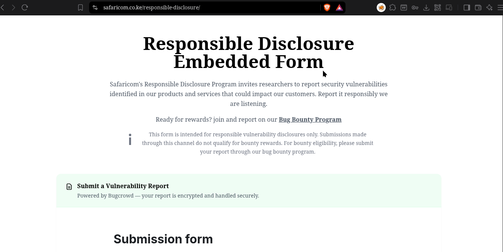
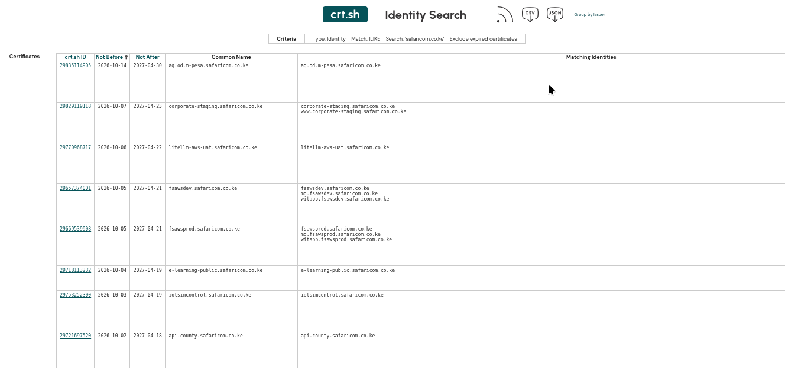
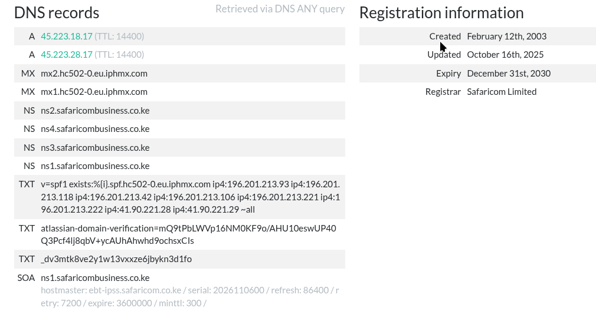
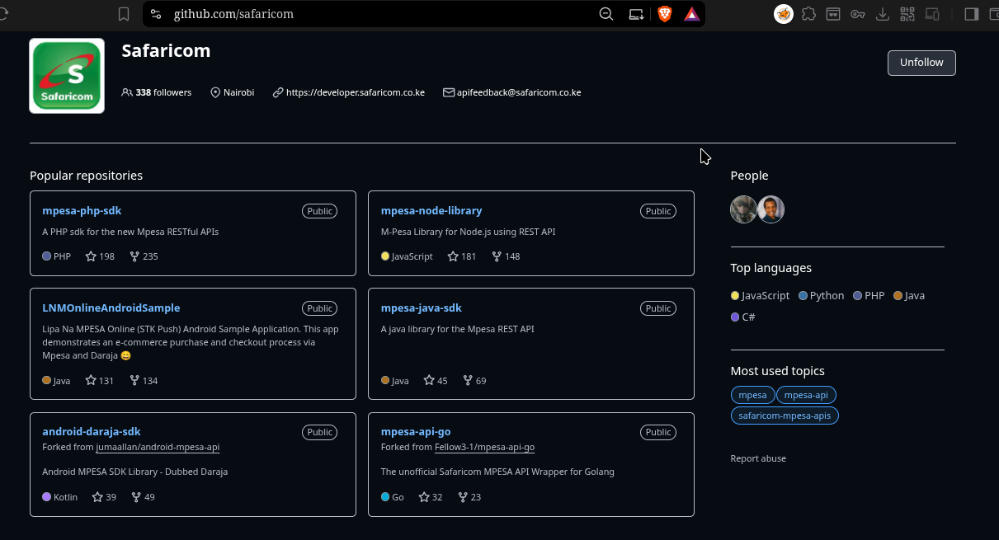

# Passive Reconnaissance Report: Safaricom PLC

**Assignment:** Offensive Recon Fundamentals - Mission
**Target:** Safaricom PLC (`safaricom.co.ke`)
**Date:** 11 November, 2026
**Analyst:** S4NTRX

---

## 1. Target & Scope Definition

*   **Target Organization:** Safaricom PLC
*   **Primary Domain:** `safaricom.co.ke`
*   **Public Disclosure Policy:** [https://www.safaricom.co.ke/responsible-disclosure/](https://www.safaricom.co.ke/responsible-disclosure/)
*   **Bug Bounty Platform:** Bugcrowd (Official program contact: `bugbounty@safaricom.co.ke`)

> **Analyst Note:** Safaricom transitioned its bounty program to Bugcrowd in late 2024. This report strictly adheres to passive reconnaissance to avoid any violation of their infrastructure rules. Out-of-scope assets (e.g., `dev`, `staging`, `uat`) were noted but not touched.

**Scope Confirmation Screenshot:**

---

## 2. Methodology & OSINT Sources

This reconnaissance was conducted entirely passively. **No port scans, header probes, or direct HTTP requests were sent to Safaricom infrastructure.**

The following OSINT source classes and tools were utilized:

1.  **Certificate Transparency (CT) Logs:** `crt.sh` was used to enumerate historical and current subdomains via SSL/TLS certificate issuance records.
2.  **DNS & Network Infrastructure:** `URLScan.io` and public DNS records were queried to map NS/MX records and identify hosting ASNs.
3.  **Social Media & Human Intelligence:** `LinkedIn` was searched for technical roles to infer the technology stack.
4.  **Public Code Repositories:** `GitHub` was queried for public repositories associated with the organization.

**Certificate Transparency (crt.sh) Screenshot:**

**DNS / ASN Analysis Screenshot:**

**Code Repository Analysis Screenshot:**

---

## 3. Subdomain Inventory

Based on passive enumeration via `crt.sh`, a total of **404** unique subdomains were identified.

**Three Examples:**
1.  `authdxl.safaricom.co.ke`
2.  `azurevpn.safaricom.co.ke`
3.  `business.safaricom.co.ke` 
---

## 4. Top Three Findings & Impact Reasoning

### Finding 1: Out-of-Scope Subdomains Exposed to Public View
*   **Observation:** Certificate Transparency logs reveal historical and active subdomains utilizing prefixes such as `dev.`, `staging.`, or `uat.`.
*   **Impact Reasoning:** While Safaricom's policy explicitly excludes these environments from bug bounties, their visibility to attackers is a risk. Development environments frequently contain test data or debug modes. If an attacker finds a vulnerability in a staging environment, it could serve as a pivot point into the production network. 

### Finding 2: Bounty Program Migration & Communication Overlap
*   **Observation:** Safaricom migrated its bug bounty program to Bugcrowd in 2024. However, the legacy Responsible Disclosure page remains active as a separate reporting channel.
*   **Impact Reasoning:** The migration indicates a maturing security program. However, running two distinct reporting channels can cause researcher confusion. If the legacy form lacks proper automated triage, critical vulnerability reports could be delayed, increasing the organization's exposure window.

### Finding 3: Third-Party SaaS Dependencies
*   **Observation:** DNS/ASN analysis of identified subdomains shows that certain services are hosted on third-party cloud providers rather than Safaricom's self-owned IP space.
*   **Impact Reasoning:** Leveraging cloud infrastructure is standard practice. However, this expands the external attack surface to include third-party SaaS dependencies. If a misconfiguration occurs (e.g., an exposed S3 bucket), the security of the associated Safaricom service is directly impacted.

---

## 5. Explicit Statement of Non-Action

To ensure strict compliance with the assignment's passive reconnaissance requirements and to respect the boundaries of Safaricom's infrastructure, the following actions were **NOT** performed:

*   **No Port Scanning:** No tools like Nmap or Masscan were used against any discovered IP addresses.
*   **No Header Probing:** No tools like cURL, Burp Suite, or ZAP were used to interact with or analyze HTTP responses from the target domains.
*   **No Active Enumeration:** No DNS brute-forcing (e.g., Gobuster, ffuf) was conducted.
*   **No Exploitation:** No vulnerabilities were tested, and no credentials were attempted.

---
*End of Report*
